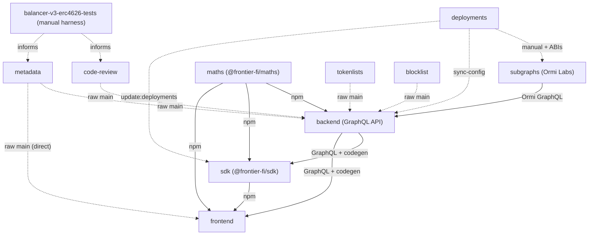

[App](https://app.frontier.fi) · [GraphQL API](https://api.frontier.fi/graphql) · [Protocol Docs](https://docs.balancer.fi) · `pnpm add @frontier-fi/sdk @frontier-fi/maths`

Live on **Ethereum** (`1`), **Base** (`8453`), **Monad** (`143`), and **Sepolia** (`11155111`) — identical CREATE2 addresses across every chain (`Vault`: `0xFF00009C1A83Ec25434522ef355b99e9a70000FF`).

Solid: runtime, npm, or GraphQL codegen · Dashed: raw GitHub <code>main</code> fetch or dev-time sync

<h3>Core contract addresses</h3>

Identical across Ethereum (`1`), Base (`8453`), Monad (`143`), and Sepolia (`11155111`). Full records and LP oracle factories live in [`deployments/addresses/_lookup.json`](https://github.com/frontier-fi/deployments/blob/main/addresses/_lookup.json).

| Contract | Address |
| --- | --- |
| `Vault` | `0xFF00009C1A83Ec25434522ef355b99e9a70000FF` |
| `Router` | `0xB3C45499aa0ad2fF5d586E7d473C75d5781c557B` |
| `BatchRouter` | `0x7D08bc34e444848983227E266F61146A7e935A94` |
| `BufferRouter` | `0xf921Cc4B31417eED5FD1B82B15B8b5549b605630` |
| `CompositeLiquidityRouter` | `0x96Eb97f030C04A98EF83191d9704e5Ba7836Bf3D` |
| `WeightedPoolFactory` | `0xC55Ea8a9de28CEDd9Eb1384CecD0D0437B71aB9a` |
| `StablePoolFactory` | `0xB74Fe587fad28adbf152b511E199665D56D40755` |
| `GyroECLPPoolFactory` | `0xED6D268cAdBea94c34E531C3401d41a882D66A8D` |
| `ProtocolFeeController` | `0x9497e26dE55Af5C87Da7F4f57EbEbAFF0DDaBc1B` |
| `Authorizer` | `0xEdFdDa22252399BDDAeE8d6D8e93c32cA3c31eeE` |

