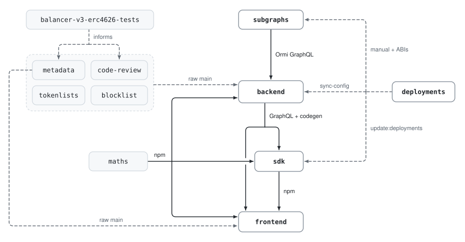

- Web app: https://app.frontier.fi
- GraphQL API: https://api.frontier.fi/graphql
- Protocol docs: https://docs.balancer.fi
- npm: [`@frontier-fi/sdk`](https://www.npmjs.com/package/@frontier-fi/sdk), [`@frontier-fi/maths`](https://www.npmjs.com/package/@frontier-fi/maths)

Live on Ethereum (`1`), Base (`8453`), Monad (`143`), and Sepolia (`11155111`) — identical CREATE2 addresses across every chain (`Vault`: `0xFF00009C1A83Ec25434522ef355b99e9a70000FF`).

  <picture>
    <source media="(prefers-color-scheme: dark)" srcset="https://raw.githubusercontent.com/frontier-fi/.github/main/profile/architecture-dark.svg">
    
  </picture>

<em>Solid: runtime, npm, or GraphQL codegen · Dashed: raw GitHub <code>main</code> fetch or dev-time sync</em>

<h3>Core contract addresses</h3>

Identical across all chains. Full records and LP oracle factories live in [`deployments/addresses/_lookup.json`](https://github.com/frontier-fi/deployments/blob/main/addresses/_lookup.json).

| Contract | Address |
| --- | --- |
| `Vault` | `0xFF00009C1A83Ec25434522ef355b99e9a70000FF` |
| `Router` | `0xB3C45499aa0ad2fF5d586E7d473C75d5781c557B` |
| `BatchRouter` | `0x7D08bc34e444848983227E266F61146A7e935A94` |
| `BufferRouter` | `0xf921Cc4B31417eED5FD1B82B15B8b5549b605630` |
| `CompositeLiquidityRouter` | `0x96Eb97f030C04A98EF83191d9704e5Ba7836Bf3D` |
| `WeightedPoolFactory` | `0xC55Ea8a9de28CEDd9Eb1384CecD0D0437B71aB9a` |
| `StablePoolFactory` | `0xB74Fe587fad28adbf152b511E199665D56D40755` |
| `GyroECLPPoolFactory` | `0xED6D268cAdBea94c34E531C3401d41a882D66A8D` |
| `ProtocolFeeController` | `0x9497e26dE55Af5C87Da7F4f57EbEbAFF0DDaBc1B` |
| `Authorizer` | `0xEdFdDa22252399BDDAeE8d6D8e93c32cA3c31eeE` |

